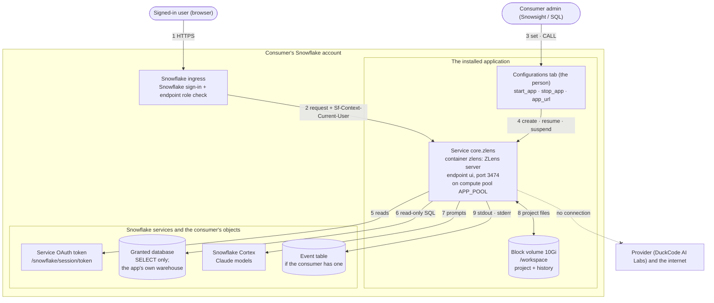

# The ZLens app for Snowflake: architecture and data flow

ZLens runs as a Snowflake Native App with containers, entirely inside the customer's (consumer's)
Snowflake account. It has one container, one public endpoint, no external access integration, and no
connection to the provider. This page shows every component and every flow of information between
them. The files it describes are in this folder: [`app/manifest.yml`](app/manifest.yml),
[`app/setup.sql`](app/setup.sql), [`app/zlens.yaml`](app/zlens.yaml).

## The flows

| # | From → to | What moves | How it is controlled |
|---|---|---|---|
| 1 | User's browser → Snowflake ingress | Page and API requests to the app's address (`*.snowflakecomputing.app`) | HTTPS. Snowflake signs the user in and lets through only roles holding the service's endpoint role, which the app grants to application role `app_user`; the consumer grants `app_user` to their roles |
| 2 | Ingress → ZLens container (port 3474, endpoint `ui`) | The same requests, with `Sf-Context-Current-User` naming the signed-in user | The ingress sets that header and replaces any copy a client sends. ZLens trusts it only inside a Snowflake container (the token file below exists) and serves only the one user the admin entered on the app's Configurations tab (an application configuration value, read while running); anyone else gets 403. Until the person is entered and a database granted, it shows the steps instead ([`snowflake-ingress.ts`](../../apps/cli/src/snowflake-ingress.ts), [`snowflake-app-settings.ts`](../../apps/cli/src/snowflake-app-settings.ts)) |
| 3 | Consumer admin → the app | The person (Configurations tab); `start_app()`, `stop_app()`, `app_url()` | The configuration value and the start and stop procedures belong to application role `app_admin`; `app_url()` to `app_user` |
| 4 | Setup script and procedures → warehouse, compute pool, service | At install the setup script creates the app's own warehouse, the pool and `core.zlens` from `zlens.yaml`, and ZLens starts; an upgrade moves the service to the new version; `stop_app()` suspends; ZLens also suspends itself after 30 idle minutes, and opening its address starts it again | The three privileges the manifest requests, which Snowflake grants at install (`manifest_version: 2`): `CREATE COMPUTE POOL`, `BIND SERVICE ENDPOINT`, `CREATE WAREHOUSE` |
| 5 | Container → `/snowflake/session/token` | The service's own OAuth token | Issued and refreshed by Snowflake; ZLens rereads it for each connection. No passwords or keys are stored |
| 6 | Container → the app's warehouse and the consumer's data | Read-only SQL: table and column metadata, and the queries that answer questions, on the app's own extra-small warehouse. Every query carries a `QUERY_TAG` and the application name, visible in `QUERY_HISTORY` | Runs as the application, so it sees only what the consumer granted: `USAGE` on one database and its schemas, and `SELECT` on their tables and views. ZLens finds the database granted to it (`SHOW DATABASES` as the app) |
| 7 | Container → Snowflake Cortex | Prompts (questions, table and column names, the semantic model, and sometimes query results) and Claude's replies | Cortex REST API inside Snowflake, signed in with the service token. The manifest requests the `SNOWFLAKE.CORTEX_USER` database role and the consumer grants it to the application (without it, Ask is off). Cortex may process a prompt in another Snowflake region only if the consumer's account allows cross-region inference |
| 8 | Container ↔ block volume `/workspace` | The ZLens project: connection settings, semantic model, certified blocks, notebooks, Apps; and `.dql/`: the catalog cache, questions and answers with their SQL, run history, and the three latest pre-upgrade backups | The volume belongs to the service in the consumer's account. It survives suspend, resume and upgrades. Snowflake deletes it only when the service is dropped with `FORCE` (it refuses a plain `DROP SERVICE` while the volume holds data that has no snapshot) |
| 9 | Container → event table | Operational messages on stdout and stderr: start-up, warnings, errors | Collected only if the consumer has an event table. ZLens does not log question text, SQL or result rows; an error message can name a table or column |
| – | Container → provider, internet | Nothing | No external access integration is requested, so the service has no outbound internet. The image also runs with `ZLENS_NO_EGRESS=1`: no update checks, no driver or extension downloads (the Snowflake driver is in the image) |

## Components

| Component | What it is |
|---|---|
| Container `zlens` | The ZLens server (Node.js 24 on `node:24-trixie-slim`, Debian 13), running as the unprivileged `node` user (uid 1000), built from this repository's [`Dockerfile`](../../Dockerfile) with the Snowflake Node.js driver included. Code in the image: `/opt/dql` (server and CLI), `/opt/dql/templates/starter`, `/opt/zlens/drivers`, `/usr/local/bin/dql-docker-entrypoint` |
| Service `core.zlens` | One container; one endpoint `ui` on port 3474 (`public: true`, reached only through the ingress); readiness probe `GET /api/health` on port 3474, called by Snowflake inside the service |
| Compute pool `<application name>_POOL` (`APP_POOL` in the diagram) | `CPU_X64_XS`, one node, created at install; suspends 10 minutes after its service stops (`stop_app()`, or ZLens stopping itself after 30 idle minutes) |
| Warehouse `<application name>_WH` | The app's own, created at install: `XSMALL`, suspends after 60 seconds idle |
| Block volume | 10Gi at `/workspace` |
| Application roles | `app_admin` (includes `app_user`) and `app_user` |
| Schemas | `core` (the service) and the versioned `app_public` (the three procedures) |

The app has no UDFs, no external functions, no external access integrations, and no network rules.
It reads no data from the provider's account.
